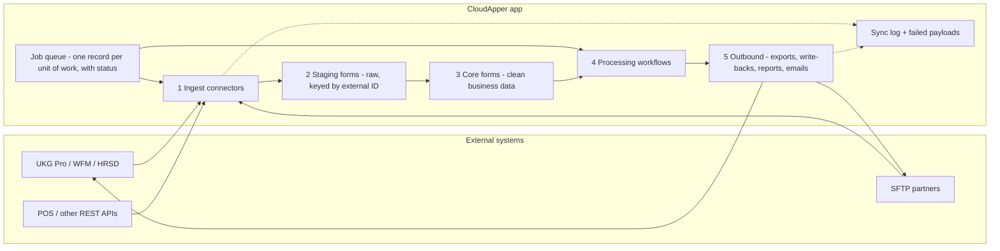

# Integration architecture for scalable CloudApper solutions

Use when designing a new app or integration (UKG, POS, payroll, any REST API or SFTP partner), or when an existing one is slow or fragile. Pair with conventions.md (naming, workflow rules) and integrations-ukg.md (endpoints).

## Contents
1. Recommended pattern
2. Layers
3. Choosing how to connect
4. Efficiency rules
5. Configuration makes it reusable
6. Inside CloudApper or in middleware
7. Design checklist

## 1. Recommended pattern

**Hub-and-spoke with a staging layer and a job-queue pipeline.** CloudApper is the hub (business data, rules, approvals, reports, UX); each external system is a spoke behind its own connector workflow. Data comes in, is cleaned and stored, processed step by step and sent out, each step driven by records with a status. A typical shape: a scheduled job creates one record per unit of work with a status, that status starts the calculation, the calculation starts the external syncs through job records, and summaries and reports come out at the end.

## 2. Layers

| Layer | Role | Rules |
|---|---|---|
| 1 Ingest | One workflow per external system and direction ("UKG WFM - Pull Time Entries"). | Fetch and store only; no business logic. |
| 2 Staging | Raw data close to the source shape, keyed by external ID. | Upsert on the external ID; keep the sync timestamp. |
| 3 Core | Clean, normalised records (Employee, Time Entry, Transaction) used by everything else. | One canonical shape per entity regardless of source, so changing a vendor only changes ingest. |
| Job queue | A job record per unit of work (location + date + type), Pending → Running → Completed / Failed. | Everything starts from a job record (schedule, button, rerun, batch): this is how you scale, retry and observe. |
| 4 Processing | Calculations and rules. | Reads core data only, never calls external systems; idempotent (run stamp + one bulk cleanup). |
| 5 Outbound | Exports, write-backs (UKG paycodes, HRSD documents, payroll files), reports, emails. | Own workflows and failure route; store the payload so it can be resent. |
| Observability | Sync Log record per run (start, end, counts, errors); Failed Payload form with a Resend button. | First place to look when something is wrong. |

## 3. Choosing how to connect

| Situation | Best fit | Why |
|---|---|---|
| Near real time, small changes | Webhook in (Incoming Webhook trigger), when the vendor can push | No polling; work starts only on change. |
| Regular sync, medium volume | REST pull, incremental (`dateTimeChanged`, `updated_after`, date filter), batched (`multi_read`), paged | One call per batch, only changed data. |
| Large volume / bulk / partner feeds | File via SFTP, one file per batch into staging | Few calls, easy to replay; payroll/HR systems often prefer files. |
| Heavy transformation, huge files, unsupported protocol | Small middleware (iPaaS or cloud function) posting to CloudApper's API or a webhook | CloudApper keeps the business logic and UX. |

SFTP: confirm whether the tenant has an SFTP connector before designing around it; otherwise a small middleware moves files between SFTP and a CloudApper webhook / REST endpoint.

## 4. Efficiency rules

- **Batch, don't loop:** `multi_read` and paged endpoints; never one API call per employee inside a FOREACH.
- **Incremental:** keep a "last synced" watermark per source and location in a setup record; pull only changes.
- **Tokens:** one per run or batch; not per item, and not one for a very long run.
- **Reuse recent syncs:** a short reuse window (e.g. 15 minutes for syncs keyed by site + date) avoids duplicate pulls in batches.
- **Partition work:** one job per location + date + period; small jobs fail and retry independently and show progress. Stagger schedules across locations.
- **Platform limits:** lookups default to about 2,000 rows; triggered runs of one workflow go one at a time (don't start two big batches together); keep loops small and use single bulk delete/update steps.
- **Upsert everywhere:** scheduled syncs use Save Records keyed on the external ID.
- **Safe failure and retry:** every call has a failure route that sets Failed + reason; a scheduled retry picks up Failed jobs and checks what was already applied.

## 5. Configuration makes it reusable

- **Integration Settings record per external system and environment:** base URL, tenant, endpoint paths, batch size, watermark, enabled flag. UAT → Production promotion changes records, not workflows.
- **Credentials in the credentials store**, referenced by connectors; never typed into nodes or copied with workflows.
- **Mapping records** (pay codes, cost centers, location ↔ external IDs) instead of values in expressions.
- **Per-location behaviour from one source** (Location type/flag), used identically in buttons, workflows and reports, and visible on the form.

## 6. Inside CloudApper or in middleware

- **Inside:** business rules, approvals, calculations on modest volumes (hundreds to low thousands of records per job), screens, reports, notifications.
- **Middleware:** very large files, heavy transformations, protocols CloudApper lacks, or loads needing tens of thousands of records per run. CloudApper then receives clean, batched data.

## 7. Design checklist

- [ ] Each external system has ingest / outbound workflows of its own, named `<System> - <Direction> <Entity>`.
- [ ] Staging and core forms keyed by external ID; syncs upsert.
- [ ] Work is split into job records with a status lifecycle and a failure status + reason.
- [ ] Incremental pulls with a stored watermark; batched calls; one token per run or batch.
- [ ] Integration Settings, mapping records and credentials store, no hard-coded URLs, IDs or secrets.
- [ ] Sync Log and Failed Payload records, with a resend path.
- [ ] Processing reads core data only and is idempotent.
- [ ] Workflow order documented; schedules staggered; batch size within platform limits.
- [ ] Middleware decision recorded for anything bulky or unsupported.
